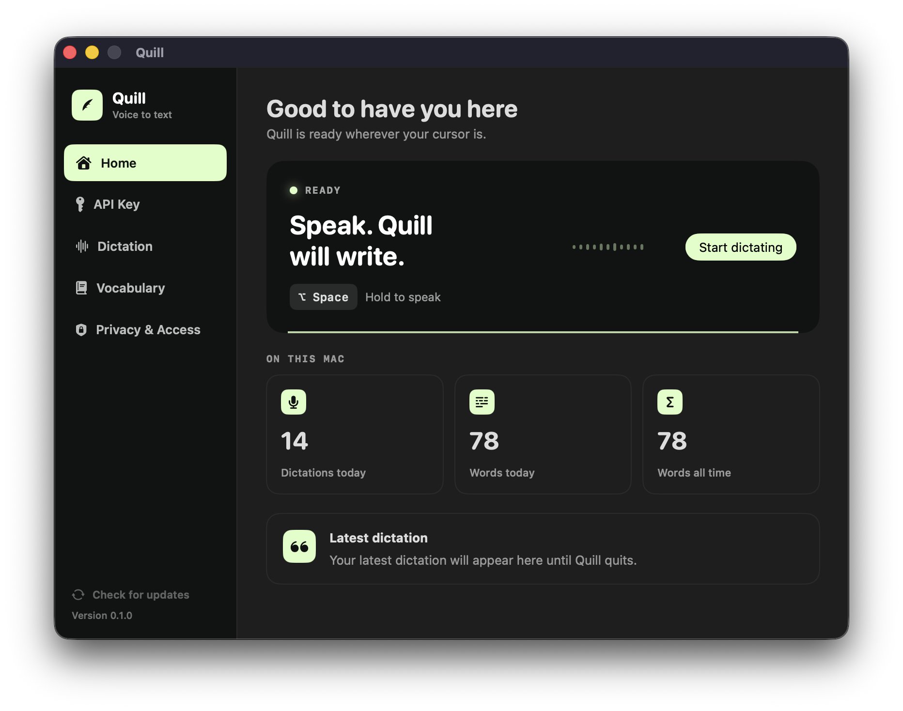

  

<h1 align="center">Quill</h1>

  <strong>Fast, system-wide voice typing for macOS.</strong> 
  Speak naturally, then let Quill place your words wherever you are writing.

  macOS 14+ &nbsp;·&nbsp; Open source &nbsp;·&nbsp; Local Bark or configurable Gemini

---

Place your cursor in an editable field, hold <kbd>⌥ Option</kbd> + <kbd>Space</kbd>, speak, and release. Your transcript appears at the original cursor so you can keep working without changing context.

  

## Features

- **Dictate across macOS:** Write in browsers, editors, messaging apps, and other standard text fields.
- **Use the workflow you prefer:** Choose hold-to-speak or press-to-start/stop dictation.
- **Customize every shortcut:** Record any modified-key shortcut for dictation and for pasting your latest transcript.
- **Choose your microphone:** Follow the macOS default input or select a specific connected microphone.
- **Choose your transcription model:** Underdog Bark 3.0 runs locally by default on supported Macs; Gemini remains available with your own API key and model ID.
- **Keep audio on your Mac:** Bark transcribes English verbatim and works offline after its one-time model download.
- **Get cleaner text with Gemini:** Smart mode improves punctuation and readability; Verbatim mode stays closer to your exact words.
- **Speak in your language with Gemini:** Let Quill detect the language or select a preferred language.
- **Teach Gemini your terminology:** Add names, technical terms, acronyms, and product vocabulary.
- **See what is happening:** A lightweight floating indicator responds while Quill listens and processes speech.
- **Track simple local usage:** View daily and lifetime dictation and word counts without saving transcript history.

## Getting started

### What you need

- **Bark:** An Apple Silicon Mac running macOS 15 or later, plus internet access for a one-time model download of about 202 MB. No API key or Python installation is needed.
- **Gemini:** A Mac running macOS 14 or later and a Gemini API key with access to a compatible Live transcription model.

New installations default to Bark. Existing installations keep their Gemini configuration when upgrading. Switch models anytime in **Settings → Models**. Bark currently transcribes English verbatim; Smart cleanup, language selection, and custom vocabulary apply only to Gemini.

### Get a Gemini API key (optional)

1. Open the [Google AI Studio API keys page](https://aistudio.google.com/app/apikey) and sign in with your Google account.
2. Select **Create API key**, then choose or create a Google Cloud project when prompted.
3. Copy the generated key and save it under **Settings → Models → Gemini**, or choose Gemini during onboarding.

The model field accepts either `gemini-3.5-transcribe-live` or `models/gemini-3.5-transcribe-live`. If transcription fails, the full error stays visible in **Home** and **Models** until dismissed or you start again. If Google reports depleted prepaid credits, add credits in [Google AI Studio](https://ai.studio/projects) or save a key from a funded project.

### Set up Quill

1. Move `Quill.app` to your **Applications** folder and open it.
2. Follow onboarding to allow **Microphone** and **Accessibility** access.
3. Download Bark during onboarding, or choose Gemini and save your API key. Then finish setup.
4. Click inside any editable text field.
5. Hold <kbd>⌥ Option</kbd> + <kbd>Space</kbd>, speak, then release.

Quill remains available from the menu bar. Open its settings to change the shortcuts, microphone, dictation behavior, transcription style, language, vocabulary, launch-at-login preference, or transcription model.

## Everyday controls

| Action | Default behavior |
| --- | --- |
| Start dictating | Hold <kbd>⌥ Option</kbd> + <kbd>Space</kbd> |
| Finish and insert | Release the shortcut |
| Paste the latest transcript again | Press <kbd>⌃ Control</kbd> + <kbd>⌥ Option</kbd> + <kbd>V</kbd> |
| Cancel dictation | Press <kbd>Esc</kbd> |
| Open Quill | Select the Quill icon in the menu bar |
| Change the model or Gemini API key | Open **Settings → Models** |
| Check for updates | Choose **Quill → Check for Updates…** or use the button in the app sidebar |

Both global shortcuts are customizable from **Settings → Dictation**. Click a shortcut field, then press any non-modifier key together with Command, Option, Control, or Shift. Microphone selection is on the same page. If a specifically selected microphone is unavailable, Quill temporarily uses the current macOS default without forgetting the preferred device.

## Privacy and local data

Accessibility permission is used only to return focus to the original text field and insert the completed transcript. Microphone permission is used only while dictation is active. Bark processes audio locally on your Mac. When Gemini is selected, audio streams directly to Google for transcription. Quill does not save audio or transcript history. The Gemini API key is saved in a local file restricted to your user account.

## Development

See [Building Quill from Source](docs/BUILDING.md) for local development, testing, release signing, and GitHub publishing instructions.

## License

Quill is available under the [Apache License 2.0](LICENSE), except for the adapted Bark runtime portions licensed under CC BY 4.0. See [Bark attribution and license details](docs/BARK.md).
